<p align="center">
  
</p>

```sql
-- quem sou eu, em uma consulta
SELECT nome, cargo, foco, cidade
FROM   pessoas
WHERE  github = 'Marcelosreiss';
```

| nome | cargo | foco | cidade |
|:--|:--|:--|:--|
| Marcelo Reis | Analista de Dados | Engenharia de Dados · Power Platform | Parauapebas, PA |

<sub>1 linha retornada · 0,002 s</sub>

<br>

Transformo processos manuais e planilhas soltas em **apps, automações e painéis** que as pessoas usam de verdade. Agora estou indo mais fundo no caminho do dado: **APIs, pipelines e modelagem**.

<br>

### 🛠️ Stack

<p align="center">
  
</p>

<br>

### 🔄 Pipeline atual

```text
 [ fonte ]            [ tratamento ]          [ destino ]            [ entrega ]
 API Sistema Prover ─▶ Python + Pandas ──────▶ SQL ─────────────────▶ Power BI
 Arquivos de RH     ─▶ Python ───────────────▶ SharePoint ──────────▶ Power Apps
```

<br>

### 🎓 Formação em andamento

- **Engenharia de Software** · Anhanguera

<br>

<p align="center">
  
</p>

<p align="center">
  <a href="https://www.linkedin.com/in/marcelo-reis-845213312/)">LinkedIn</a> ·
  <a href="Msreis_@hotmail.com">E-mail</a> ·
  <a href="https://www.instagram.com/SEU-USUARIO">Instagram</a>
</p>
